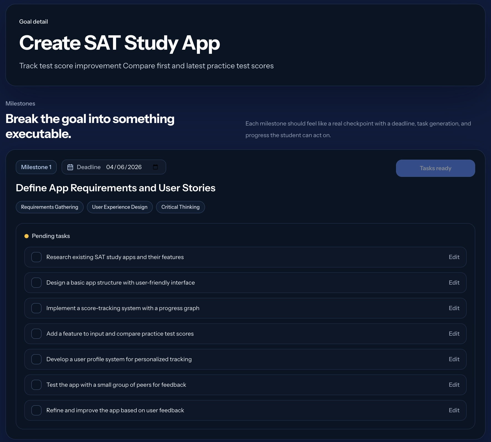
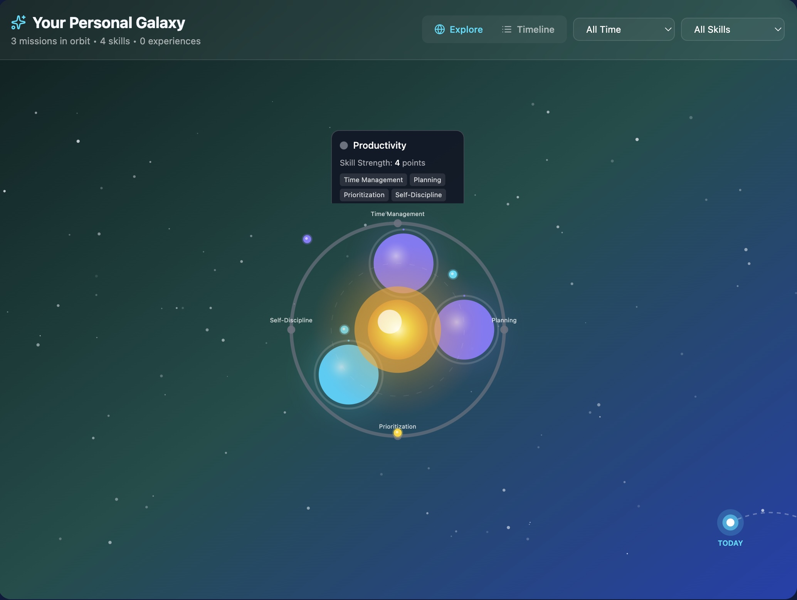
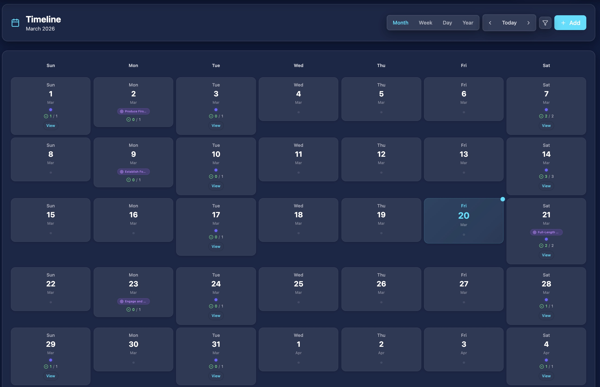

# Arc

**Arc turns a big goal into today's move.**

[arcgoalgetter.com](https://arcgoalgetter.com)

Arc is a goal-planning app for high school students. A student describes what they want to achieve, and Arc turns it into a concrete goal, breaks it into milestones and weekly tasks, and schedules that work around the time they actually have. Progress is tracked with streaks, XP, and achievements, and the skills earned along the way build into a resume.

Arc has 200+ monthly users and placed 3rd out of 1,300+ students in the Ventura pitch competition.

## Features

- **AI goal breakdown.** Turns an open-ended goal into milestones and weekly tasks, scheduled around the student's availability.
- **Galaxy dashboard.** Goals show up as orbiting planets with live progress.
- **Timeline.** Day, week, month, and year views with conflict detection and calendar (`.ics`) export.
- **Gamification.** XP, coins, ranks, daily streaks, achievements, and a shop.
- **Mini-Arcs.** Short 1 to 4 week skill programs that end with a real deliverable.
- **Resume builder.** Generates a resume from completed goals and logged skills.
- **ArcConnect.** Peer matching, messaging, and audio calls between students.

## About this repo

This is Arc's frontend. The backend (the Convex functions for data, auth, and AI calls) is in a separate private repo, so this code won't run on its own. You can still read through the app, the UI, and how it talks to the backend.

Arc is built by Andrey Vasilyev, Garv, and Aditya. I handle the engineering side: connecting the APIs, deploying and hosting the app, and integrating MicroDC for the AI features.

## AI inference

Arc's planning features run on [MicroDC](https://microdc.ai) using `gpt-oss:120b` through its OpenAI-compatible API.

Two things I learned that might help anyone using the same models:

1. **`gpt-oss` models reject `max_tokens` below 4096** unless you send `thinking: false`. For structured or JSON output you usually want thinking off anyway, since it's faster and the response comes back clean.
2. **Plan for cold starts.** A request that has to load a cold model can take 60 to 90 seconds, while warm requests come back in a few seconds. Set a generous client timeout. Arc uses 120s.

## Tech stack

React 19, TypeScript, Vite, Tailwind CSS, shadcn/ui, Framer Motion, React Router 7, and [Convex](https://convex.dev).

## Security note

The `/admin` and usage dashboards are gated by a passphrase read from `VITE_ADMIN_PASSWORD`. That check runs in the browser, so it's a convenience gate and not real security, since anything shipped to the client can be read by the user. Real authorization has to happen on the server.

## License

[MIT](./LICENSE) © 2026 Andrey Vasilyev
